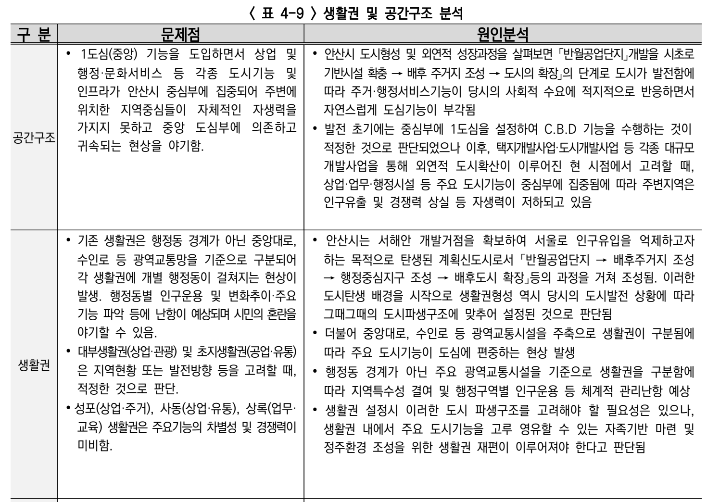
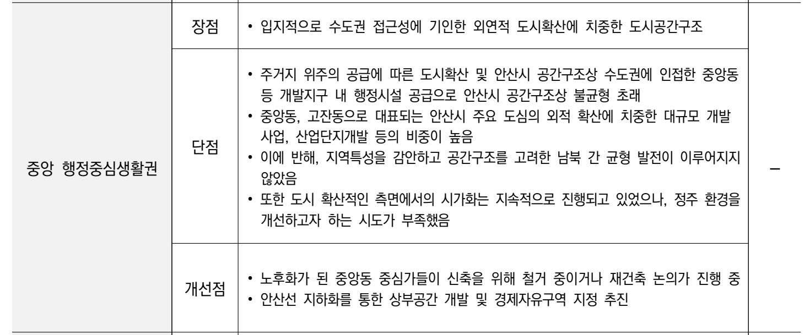

# 5개 시 비교보고서

## 안산의 여가 여건과 수도권 도시 비교

**안산 · 수원 · 안양 · 시흥**

조사 기준일: 2026.11.07 | 공개자료 조사·비교

> **비교 범위 안내:** 파일명은 요청에 따라 `5개 시 비교보고서.md`로 지정했습니다. 원본 PDF 「안산_수원_안양_시흥_여가여건_비교보고서.pdf」의 비교 대상은 위 **4개 도시**입니다. 군포는 원본 보고서에 포함되어 있지 않습니다. 별도로 제공하는 [도시별 상권 이미지](assets/README.md)는 군포를 포함한 5개 도시 자료입니다.

### 핵심 판단

안산은 수원·안양보다 여가 불만족률이 높고, 공표된 지역별 격차도 크게 나타난다. 다만 시흥보다 전체 불만족률이 낮으며, 안양도 상당한 내부 격차가 있다. “안산만의 문제”나 “수도권에서 가장 심각한 도시”라고 단정할 근거는 부족하다.

## 1. 도시 전체의 여가 여건

| 도시 | 전반적 여가활동 불만족률 | 문화여가시설 접근성·충분 정도 불만족률 |
| --- | ---: | ---: |
| 안산 | 22.1% | 18.9% |
| 수원 | 16.2% | 14.4% |
| 안양 | 18.8% | 16.7% |
| 시흥 | 29.1% | 27.5% |

자료: 2025년 각 시 사회조사 공통 문항, 15세 이상 대상. [2]~[5]

안산의 전반적 여가 불만족률은 수원보다 5.9%p, 안양보다 3.3%p 높고, 시흥보다 7.0%p 낮다. 시설 여건에 대한 불만족률도 같은 순서로 나타난다.

### 안산시 조사에서 확인되는 위치

안산 전체의 여가 불만족률 22.1%는 경기도 23.7%보다 낮다. 따라서 도시 전체가 경기도 평균보다 불만족이 높다고 설명하기보다, 상록구와 단원구 사이의 차이에 주목하는 것이 적절하다. [2]

### 집계 기준과 해석

전반적 여가 불만족률은 보고서의 합산 공표값을 사용했다. 시설 불만족률은 “약간 불만족”과 “매우 불만족”을 합산했다. 안양은 반올림된 성분의 합 18.7% 대신 합산 공표값 18.8%를 사용했다.

이 비교는 조사 결과의 관측 차이다. 표본오차에 대한 유의성 검정이나 연령·소득 구성 보정은 수행하지 않았으므로, 수치 순서를 확정적인 우열로 해석하지 않는다.

## 2. 생활권에 따라 달라지는 여가 여건

| 도시 | 불만족률이 높은 지역 | 낮은 지역 | 격차 |
| --- | --- | --- | ---: |
| 안산 | 상록구 28.2% | 단원구 15.2% | 13.0%p |
| 안양 | 만안구 25.5% | 동안구 13.8% | 11.7%p |
| 수원 | 팔달구 21.6% | 권선구 12.7% | 8.9%p |
| 시흥 | 북부권 33.6% | 남부권 26.4% | 7.2%p |

격차 = 공표된 구·권역별 전반적 여가 불만족률의 최댓값 - 최솟값. [2]~[5]

확인한 네 도시 중 안산의 공표 지역 간 격차가 가장 크다. 그러나 안양과의 차이는 1.3%p이며, 이 차이가 통계적으로 유의한지는 확인하지 않았다.

### 지역별 상세 수치

| 지역 | 전반적 여가 불만족 | 시설 여건 불만족 |
| --- | ---: | ---: |
| 안산 상록구 | 28.2% | 23.5% |
| 안산 단원구 | 15.2% | 13.6% |
| 수원 장안구 | 20.5% | 17.6% |
| 수원 권선구 | 12.7% | 11.9% |
| 수원 팔달구 | 21.6% | 18.6% |
| 수원 영통구 | 13.6% | 11.4% |
| 안양 만안구 | 25.5% | 21.9% |
| 안양 동안구 | 13.8% | 12.8% |
| 시흥 북부권 | 33.6% | 31.1% |
| 시흥 남부권 | 26.4% | 25.4% |

### 비교의 한계

안산·안양은 각각 2개 구, 수원은 4개 구, 시흥은 2개 권역이다. 지역 구획과 개수가 다르므로 위의 격차는 엄밀한 도시 전체 불평등지수가 아니다. 그럼에도 안산 내부에서 여가 여건을 다르게 체감하는 집단이 존재한다는 점은 확인된다.

## 3. 도시 밖으로 향한 관광 목적 이동

**2026년 8월 · 잠정 참고값**

비교 범위는 각 도시에서 출발해 해당 시 밖의 전국 목적지로 향한 관광 목적 이동이다. 도착지를 특정 도시로 제한하지 않고, 같은 시 안의 이동은 제외했다. 기간·목적·성별·연령 조건을 네 도시에 동일하게 적용했다. [6]

| 출발 도시 | 시외 관광 목적 이동량 | 상대 규모 (안산=100) |
| --- | ---: | ---: |
| 안산 | 121,952 | 100.0 |
| 수원 | 175,081 | 143.6 |
| 안양 | 87,855 | 72.0 |
| 시흥 | 58,491 | 48.0 |

자료: 경기도 생활이동소비 분석 상황판에서 내려받은 원본 CSV. 2026.08 / 유출 / 관광 / 전 성별·연령 / 전국 도착 / 동일 시내 이동 제외. 표시 단위는 명이며, 반복 이동을 포함한 누적 추정 이동량으로 해석한다. [6][7]

### 비교 결과

조회된 시외 관광 이동량은 수원 175,081, 안산 121,952, 안양 87,855, 시흥 58,491 순이다. 안산은 수원보다 적고 안양·시흥보다 많다. 상대 규모는 안산을 100으로 놓고 이동량만 환산한 값이며, 인구 차이를 보정한 지표가 아니다.

### 이동 규모와 관광 유출률은 다르다

이 표는 해당 도시에서 시작된 이동을 센 것이다. 해당 도시 거주자만을 집계한 고유 관광객 수가 아니므로, “안산 시민이 다른 도시 시민보다 시외 관광을 더 많이 한다”거나 “지역의 관광 매력이 낮다”는 결론을 바로 내릴 수 없다.

### 해석에 필요한 추가 조건

도시별 외부 관광 의존도를 비교하려면 거주지를 기준으로 한 시외 관광 이동을 파악하고, 동일한 정의의 시내·시외 관광 이동 전체를 분모로 사용해야 한다. 현재 자료에서는 이 비율을 계산하지 않았다. 또한 한 달의 여름철 자료로 연중 경향을 판단할 수 없다.

### 집계 확인이 필요한 잠정 자료

같은 조사에서 안산의 관광 목적 시외 유입은 14, 시내 이동 포함·제외 값의 차이는 22로 관측됐다. 분류 범위나 집계 방식의 확인이 필요한 결과이며 원인은 확인되지 않았다. 따라서 위 수치는 관측된 조회값을 비교하는 보조자료로만 제시하고, 관광객 총량·순유출·시외 관광 비율의 확정 근거로 사용하지 않는다.

관광 목적은 KT 통신자료의 체류지 특성과 이동 동선 등에 따른 추정 분류다. 외식·문화생활 등 모든 여가 활동을 포괄하는 지표는 아니다. [7]

## 4. 도시기본계획에 나타난 집중 구조

2040 안산 도시기본계획은 반월공업단지에서 시작된 도시 확장과 주요 기능의 도심 집중, 주변 지역중심의 자생력 저하를 진단한다. 아래는 원문을 재작성하지 않고 해당 영역을 발췌한 이미지다. [1]

### 182쪽 · 표 4-9 「생활권 및 공간구조 분석」

### 185쪽 · 표 4-15 중 「중앙 행정중심생활권」

인쇄 쪽수와 PDF 쪽수가 동일하다. 이 계획의 진단은 도시 형성의 맥락을 설명하며, 현재의 인파나 소비 집중도를 직접 측정한 통계는 아니다.

## 5. 비교를 반영한 문제 정의

안산은 산업단지 배후도시로 성장하는 과정에서 도심 기능 집중과 주변 생활권의 자생력 저하가 공식적으로 진단된 도시다. 시민 조사에서도 상록구와 단원구 사이에 여가 불만족률 차이가 나타난다. 따라서 생활권별 자원을 연결하고 지역 간 방문·체험 기회를 넓히는 문제에 초점을 맞출 수 있다.

이 문장은 공식 진단과 조사 결과를 결합한 기획상의 해석이다. 두 자료만으로 공간구조가 여가 불만족을 일으켰다는 인과관계를 입증한 것은 아니다. 또한 생활권 격차는 다른 도시에서도 나타난다.

## 출처 및 확인 위치

| 번호 | 출처 | 확인 위치·조건 |
| --- | --- | --- |
| [1] | [안산시, 2040 안산 도시기본계획](https://ansan.go.kr/www/common/bbs/selectBbsDetail.do?bbs_code=WWW17&bbs_seq=1608849) | 제1~5장 자료, 인쇄/PDF 182쪽 표 4-9 및 185쪽 표 4-15 |
| [2] | [안산시, 2025년 사회조사](https://ansan.go.kr/stat/common/bbs/selectBbsDetail.do?bbs_code=B0688&bbs_seq=1659328) | 2026.01.05 수정본. 인쇄 45~46쪽 / PDF 49~50쪽 |
| [3] | [수원시, 2025년 사회조사](https://news.suwon.go.kr/ebook/home/view.php?host=main&site=20260128_075352) | 공식 전자책 인쇄 71~72쪽 / 뷰어 79~80쪽 |
| [4] | [안양시, 2025년 제11회 사회조사](https://m.anyang.go.kr/main/selectBbsNttView.do?bbsNo=52&key=243&nttNo=427049) | 인쇄 69~70쪽 / PDF 79~80쪽 |
| [5] | [시흥시, 2025년 제11회 사회조사](https://www.siheung.go.kr/main/bbs/view.do?mId=0306040000&bIdx=181870&ptIdx=30) | 인쇄 69~70쪽 / PDF 79~80쪽 |
| [6] | [경기도 생활이동소비 분석 상황판](https://www.webasp.kr/mop) | 2026.08, 관광, 유출, 전 성별·연령, 전국 도착, 시내 이동 제외. 각 도시의 원본 CSV 집계값 비교 |
| [7] | [경기도 생활이동소비 분석 상황판 매뉴얼](https://www.webasp.kr/ASP_userManual_261019_2.pdf) | PDF 7쪽 데이터 정의, 26쪽 출발지·도착지 기준, 61쪽 이동량 산식 |

## 재현 및 자료 보관

확인일: 2026.11.07. 사회조사는 2025년, 시외 관광 이동은 2026년 8월 기준이다. 조사와 통신 기반 이동 자료를 결합해 인과관계나 주민 유출률을 계산하지 않았다.

원본 보고서는 `비교결과와_출처.json`, 도시별 사회조사 원문·발췌 이미지와 이동 조회 원본 CSV를 로컬 프로젝트의 `docs/research/2026-11-07-ansan-city-comparison` 폴더에 보존했다고 명시한다. 해당 원자료 폴더는 이번 업로드에 포함하지 않았다.

이 Markdown은 원본 PDF의 본문, 수치, 출처와 발췌 이미지 2장을 옮긴 것이다. PDF의 반복 머리말·꼬리말과 페이지 번호는 생략했다.
