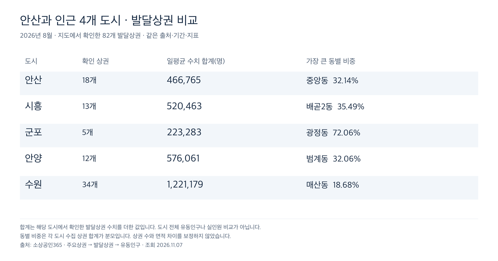

# 도시별 상권 이미지

안산·시흥·군포·안양·수원의 그래프와 표를 모은 PNG 이미지 **19장**입니다. 별도로 비교보고서의 원문 발췌 이미지 **2장**을 `보고서/`에 보관합니다. 이 폴더의 PNG는 총 **21장**입니다.

[5개 시 비교보고서 읽기](../5개%20시%20비교보고서.md) · [5개 도시 유동인구 비교 이미지](00_도시별_비교.png)

> 보고서의 파일명은 요청한 이름을 사용했습니다. 보고서 본문은 원본 PDF에 있는 안산·수원·안양·시흥 **4개 도시** 비교이며, 아래 상권 이미지는 군포를 포함한 **5개 도시** 자료입니다.

| 폴더 | 이미지 수 | 내용 |
| --- | ---: | --- |
| [안산](안산/) | 4 | 상권별 유동인구, 동별 구성비, 대응표, 식사·카페 매출 |
| [시흥](시흥/) | 3 | 상권별 유동인구, 동별 구성비, 대응표 |
| [군포](군포/) | 3 | 상권별 유동인구, 동별 구성비, 대응표 |
| [안양](안양/) | 3 | 상권별 유동인구, 동별 구성비, 대응표 |
| [수원](수원/) | 5 | 상권별 유동인구 2장, 동별 구성비, 대응표 2장 |
| [도시 비교](00_도시별_비교.png) | 1 | 5개 도시 비교 |
| [보고서](보고서/) | 2 | 2040 안산 도시기본계획 원문 발췌 |

## 비교 이미지 미리보기

## 도시별 이미지 바로가기

| 도시 | 상권별 유동인구 | 동별 구성비 | 상권·동 대응표 | 추가 자료 |
| --- | --- | --- | --- | --- |
| 안산 | [그래프](안산/01_상권별_유동인구_1.png) | [그래프](안산/02_동별_유동인구_비중.png) | [표](안산/03_상권_동_비중표_1.png) | [식사·카페 매출](안산/04_식사카페_매출.png) |
| 시흥 | [그래프](시흥/01_상권별_유동인구_1.png) | [그래프](시흥/02_동별_유동인구_비중.png) | [표](시흥/03_상권_동_비중표_1.png) | - |
| 군포 | [그래프](군포/01_상권별_유동인구_1.png) | [그래프](군포/02_동별_유동인구_비중.png) | [표](군포/03_상권_동_비중표_1.png) | - |
| 안양 | [그래프](안양/01_상권별_유동인구_1.png) | [그래프](안양/02_동별_유동인구_비중.png) | [표](안양/03_상권_동_비중표_1.png) | - |
| 수원 | [1](수원/01_상권별_유동인구_1.png) · [2](수원/01_상권별_유동인구_2.png) | [그래프](수원/02_동별_유동인구_비중.png) | [1](수원/03_상권_동_비중표_1.png) · [2](수원/03_상권_동_비중표_2.png) | - |

## 유동인구 자료 기준

- 출처: [소상공인365 지도](https://bigdata.sbiz.or.kr/#/hotplace/gis)의 주요상권 → 발달상권 → 유동인구
- 기준 기간: 2026년 8월 / 조회일: 2026년 11월 7일
- 지표: 상권별 일평균 유동인구
- 지도에서 확인한 상권: 안산 18개, 시흥 13개, 군포 5개, 안양 12개, 수원 34개
- 동별 비중은 해당 도시에서 수집한 상권 수치 합계가 분모입니다. 도시 전체 유동인구 비중이나 중복 방문을 제거한 실인원 통계가 아닙니다.
- 동 이름은 상권 선택 시 사이트에 표시되는 값입니다. 행정동·법정동을 별도로 보정하거나 상권 경계를 동별로 분할하지 않았습니다.
- 별도 전체 목록과 대조한 전수성 검증은 수행하지 않았습니다.

## 안산 식사·카페 매출 이미지

제공된 그래프의 수치와 동 순서를 유지하면서 색상과 글꼴 스타일을 맞춘 이미지입니다. 원본에 표시된 출처는 공공데이터포털 「경기도 데이터분석 카드매출 행정동 집계」이며, 기간은 2025년 9월부터 2026년 8월까지의 12개월 합계입니다.
