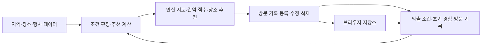

# 안산 탐험 MVP 최소 구현 계획

- 작성일: 2026-11-07
- 기준: [기획 지침서 v1.1](ansan_exploration_guidelines.md), [작업 규칙](AGENTS.md)
- 상태: 2026-11-08 사용자 요청으로 지도 중심 흐름과 실제 권역·유동인구 감점을 반영. 담당은 `.claude/state/golden-path.md`를 따른다. 최종 마감시각은 추후 확인한다.
- 이번 산출물은 개발 계획이다. 앱 구현·실행·데모 검증을 완료했다는 의미가 아니다.

## 2026-11-08 외부 평균 별점 가점 (main 반영 승인)

- 사용자가 선택한 별점 기준은 외부 지도 서비스의 장소 평균 별점이다. 개인 방문 기록·리뷰 개수와 분리한다.
- 제안한 가점은 `Q = min(평균 별점 / 5 × 30, 100 − B)`이며 모든 Lv에서 적용한다. 현재 B=70에서 4.5점이면 +27점이다. 강도 30은 검증 전 조정값이다.
- 기존 공개 페이지 스냅샷에서 네이버 평균 별점이 기재된 121건을 추출했다. 이름·주소·좌표 대조와 후보 제외 후 앱의 1,199곳 중 75곳에 연결했다. 2차 출처·확인일·지도 원문 링크를 보존하며 실시간 직접 조회값으로 표현하지 않는다.
- 나머지 1,124곳은 별점 미확인으로 가점 0이다. 0점 별점으로 채우지 않는다. 같은 입력값을 가진 장소의 동점은 여전히 가능하다.
- 최신 동네 화면 디자인을 유지한다. 카드에는 평균 별점과 접을 수 있는 출처만 표시하고 점수 계산 설명은 다시 추가하지 않는다.
- **2026-11-08 사용자 지시 “일단 main에 올려줘”로 반영 승인. 최신 디자인을 유지하고 검증 후 main에 반영한다.**

## 2026-11-08 최신 결정: 실제 20곳 전체 반영·100점 정규화

- 이전 가상 625곳과 “실제 탐색 20곳, 점수는 3곳만” 구현은 요청을 충족하지 못했다. 운영 화면은 실제 장소만 사용하며, **상세 추천에 표시한 20곳과 지역 점수에 반영한 20곳을 일치**시킨다.
- NAVER 실제 후보 2,329곳에서 관광·활동 관련 1,930곳을 수록했다. 전체 활동·2026-11-08 14:00·100 km에서 25개 동 모두 20/20을 검증한다. 방문으로 장소 점수가 바뀌면 전체 후보에서 다시 선정한다.
- 확인된 프랜차이즈·체인 의심 후보와 확인된 휴무는 제외한다. 실제 검색 출처·좌표가 있는 장소의 운영/리뷰/분류 미확인은 **잠정 점수에 포함**한다. 이는 최신 ‘20곳 모두 계산’ 요청에 맞춘 변경이며, 영업 중·비프랜차이즈로 확정한다는 뜻은 아니다.
- 리뷰 수 300곳을 공개 2차 출처와 이름·주소·좌표로 대조했다. 실제 리뷰 수가 없으면 숫자를 만들지 않고 인지도 감점 계수만 보수적으로 1로 둔다. Lv.0 인지도 감점 없음은 유지한다.
- 지역 점수는 `상위 20곳 합계 / (20×110) × 100 × (1−유동인구 감점률) × (새로움/1.2) × 거리`로 0~100점에 고정한다. 결과 집합의 최대/최솟값이나 실제 N으로 재정규화하지 않는다.
- 사용자 선택: 유동인구 감점률은 Lv.0=0, Lv.1 최대 15%, Lv.2 최대 30%. 동 표시 상권 합계를 수집 자료의 최대 동별 합계 150,039로 나눈 강도를 곱한다. 18개 상권→11개 동 연결 누락을 수정했으며 자료 없는 14개 동은 감점 보류로 표시한다.
- 팀 최신 장소 추천 카드·스크롤·친밀도 보기·내 동네 빗금·S 마커 제거를 유지한다. 현재 팀 디자인의 메인 지도는 친밀도 색상을 사용하고, 내부 0~100점은 추천 순서에 반영한다.
- [현재 데이터 계약·예시·한계](src/data/README.md). 아래 초기 가상 수치 예시는 이 최신 정책 이전의 설명 기록이며 현재 운영 점수가 아니다.

## 1. 가장 먼저 완성할 흐름

**경험·외출 조건 입력 → 안산 지도에서 권역별 점수 비교 → 권역 클릭 → 추천 장소·마커 선택 → 방문 기록 저장 → Lv·유동인구 감점·지도 점수 재계산 → 새로고침 후 유지**

지도는 탐험 메인 화면으로 함께 구현한다. 권역 카드와 장소 목록은 지도와 같은 계산 결과를 사용하며, 추천 메인 지도는 타일 없이 탐색한다. 상세 지도도 최신 팀 디자인의 손그림 SVG 경계·추억 마커를 유지해 외부 타일 없이 작동한다. 내 동네 집 표시와 사용자가 실제로 남긴 자기 신고 추억을 보존한다. 가상 추억 예시는 운영 화면에서 제거한다.

2026-11-08 변경: 추천 단위는 25개 행정동이고 운영 데이터는 실제 장소만 사용한다. 각 동 기본 20곳 표시, 전체 후보 유지, 검토된 상위 N/20 합산은 위 정정과 콘텐츠 계약을 따른다. 단위 테스트의 가상 수치는 운영 화면에 포함하지 않는다.

## 2. 가장 작은 구현 구조

별도의 로그인·공유 서버가 필요한 요구가 아직 없으므로, 첫 구현은 **한 브라우저에서 사용하는 웹앱**으로 제안한다.

| 부분 | 최소 구현안 | 한계·결정 사항 |
| --- | --- | --- |
| 화면 | React + TypeScript + Vite 단일 웹앱 | 팀이 이미 정한 기술이 있으면 그 기술을 사용한다 |
| 콘텐츠 | 지역·장소·행사 JSON | 관리 화면 대신 파일을 수정하고 앱을 다시 배포한다 |
| 사용자 상태 | 초기 경험·방문 기록을 브라우저 저장소에 저장 | 같은 브라우저·사이트에서 유지. 계정·기기 간 동기화는 제공하지 않는다 |
| 추천 | 입력과 출력을 가진 순수 함수 | 화면과 계산을 분리해 같은 입력의 결과를 재현한다 |
| 지도 | 추천 메인의 권역 경계·점수 + 선택 권역의 장소 지도 | 안산만 표현한 SVG 도식. 다각형 모서리만 완만하게, 점수에 비례한 단색 농도. 권역 클릭·장소 번호와 카드 선택 연결 |
| 검증 | 계산 경계 조건 검사 + Playwright 실제 화면 검증 | 계산 검사만으로 사용자 흐름을 완료 처리하지 않는다 |

Vite는 React TypeScript 템플릿을 제공한다. 런타임은 **Node.js 24 LTS의 팀 공통 패치 버전**을 정해 고정하는 안을 권한다. 현재 기본 Node.js 21은 실행 오류가 있고, 대체 Node.js 18은 최신 도구의 기준에 맞지 않는다. 공식 문서상 Vite의 요구 버전은 20.19+/22.12+이며, 현재 Playwright는 최신 22.x·24.x·26.x를 요구한다. [Vite](https://vite.dev/guide/), [Playwright](https://playwright.dev/docs/intro#system-requirements), [Node.js 릴리스](https://nodejs.org/en/about/previous-releases).

지도는 실제 도로지도 대신 SGIS/vuski 2026-10-01 행정동 경계를 투영한 SVG로 제공한다. 원형 버블이 아닌 다각형 경계의 모서리만 부드럽게 한다. 점수 색상은 공유 엔진의 최종 0~100점과 동일한 고정 범위를 사용한다. 동일 점수는 순위와 관계없이 동일 색상, 미제공·조건 미충족은 회색, 0점은 가장 옅은 녹색이다. 추천 메인에서는 외부 타일을 요청하지 않는다. 상세 지도도 팀 디자인의 손그림 경계·실제 좌표·번호와 하트 마커를 유지한다.



화면은 다음 세 묶음으로 시작한다. 장소 상세와 방문 기록 편집은 지역 상세 안의 패널로 제공해 별도 페이지 수를 줄인다.

| 화면 | 사용자 동작 | 보여줄 결과 |
| --- | --- | --- |
| 시작·조건 설정 | 지역별 익숙함, 관심 활동, 출발지, 날짜·시각, 최대 거리 선택 | 탐험 조건을 확인하고 추천 요청 |
| 지역 추천 | 안산 지도에서 권역 선택, 조건 변경 | 경계 색상·권역 점수·순위, 보조 카드의 추천 이유·거리·운영 확인 장소 수 |
| 지역 상세 | 장소·행사·지도 탐색, 방문 기록 등록·수정·삭제 | 장소 운영정보·행사 조건·자기 신고 기록·갱신된 Lv |

## 3. 코딩 전에 맞출 최소 데이터 계약

DB 테이블이나 API 서버 설계가 아니라 팀 코드 사이에서 주고받을 객체의 계약이다. 공통 ID와 아래 필드 이름부터 일치시킨다.

| 객체 | 필요한 정보 |
| --- | --- |
| Region | dong-행정기관코드 ID, adminCode, district, 이름, 대표 지점·출처, MultiPolygon 경계, placeIds, footfallMarketIds |
| Place | id, regionId, 이름, 분류, 좌표, 기본 가치, popularityEvidence(제공자·지표·수치·기간·출처), 가상 장소 전용 popularity, searchSource, 운영·입장 조건, 출처·확인일, franchise.status와 별도 분류 근거·확인일 |
| Event | id, placeId, 이름, 회차·기간, 취소 여부, 참여 조건, 관심 분류, 가점, 출처 |
| Profile | 지역별 초기 Lv, 사용자가 신고한 익숙함, 관심 활동, 경험한 행사 ID |
| Visit | id, placeId, 방문일, 기록 방식 self_report |
| SearchContext | 출발지 좌표, 선택한 시각, 관심 활동, 최대 직선거리 |
| RegionRecommendation | regionId, 점수, 추천 이유, 시작점 거리, 상위 20개 장소 ID, eligiblePlaceCount, placeLimit=20, shortfallCount, 운영정보 미확인 장소 수 |

실제 장소는 공식 주소·행정동 소속·운영·프랜차이즈 근거를 확인한 순서로 반영한다. 기존 시연 자료의 휴무·미확인 사례는 검증용으로 유지한다. 등록량 차이가 있는 합산 점수를 동 전체의 매력도로 해석하지 않는다. 진행 행사와 취소 행사도 준비하고, 종료·예약 조건 미확인 사례는 별도 검증 데이터로 둔다.

프랜차이즈 분류는 `non_franchise` / `franchise` / `unknown`으로 관리한다. 비프랜차이즈 확정에는 출처·확인일을 요구한다. 미확인 실제 검색 후보도 잠정 점수·Lv에 포함한다. 가맹점과 동일 브랜드 직영 체인점은 제외하며, 필드 누락·근거 없음은 미확인으로 처리한다. 제외 장소의 기존 방문 기록은 보존하지만 Lv·점수 계산에서 제외하고 초기 경험은 유지한다. 세부 기준은 기획 지침서 §13.4를 따른다.

선택한 시각은 `Asia/Seoul` 기준으로 해석한다. 운영 일정에는 예외 날짜와 입장·주문 마감을 반영하고, 밤을 넘기는 일정은 날짜별 구간으로 나눠 입력한다. 출처나 조건이 없으면 이용 가능으로 추정하지 않는다.

## 4. 최소 작업 단위와 완료 조건

각 작업은 **한 가지 확인 가능한 결과**를 만든다. 아래 시간은 익숙한 도구를 사용하는 담당자 1명의 작업 예산이며 완료 보장이 아니다. 40분을 넘길 것으로 보이면 화면 표시와 동작 연결을 분리한다. 공통 계약 이후에는 팀에서 정한 담당들이 병행할 수 있다.

| ID | 구현할 작은 결과 | 선행 | 예상 | 완료 확인 |
| --- | --- | --- | --- | --- |
| M00 | 앱 실행·빌드와 검증 명령의 기반 준비 | 없음 | 20~40분 | 공통 Node로 개발 서버와 빌드 실행. 시작 화면의 실제 브라우저 검사 실행. 미구현 단계는 전체 PASS로 보고하지 않음 |
| M01 | 공통 타입·정책 설정·25개 행정동 데이터 연결 | M00 | 20~30분 | 중복 ID·없는 regionId·운영정보 누락·프랜차이즈 분류/근거 검사. 25개 동·행정기관 코드·경계 연결, 자료 없는 동과 0점 구분, 기존 기록 보존 |
| M02 | 초기 경험과 외출 조건 입력 저장 | M01 | 20~30분 | 신규 주민 기본값 0, 기존 주민은 선택한 지역만 변경. 수동 출발지·날짜·시각·관심 활동·최대 거리 입력이 다음 화면에 전달됨 |
| M03 | 장소별 운영·이용 조건 판정 | M01 | 20~30분 | 같은 선택 시각에서 운영·휴무·미확인 구분. 미확인 장소는 점수 대상에서 빠지되 탐색 목록에는 남음 |
| M04 | 안산 지도에 권역 경계·점수·순위 표시 | M02, M03 | 30~40분 | 거리·범위·Lv·유동인구 감점·새로움이 지도와 보조 카드에 동일하게 반영됨. 점수 상승 시 색이 진해지고 같은 점수의 색은 고정. 제외 권역은 회색으로 직접 탐색 가능 |
| M05 | 권역을 선택하면 해당 장소를 탐색 | M04 | 20~30분 | 다른 권역의 장소가 섞이지 않음. 확인된 프랜차이즈·체인 의심 후보는 점수·목록·지도에서 제외하며 분류 미확인 실제 후보는 잠정 계산에 포함. 운영 상태·출처·입장 조건·관심 분류 표시. 추천에서 빠진 권역도 직접 탐색 가능 |
| M06 | 방문 1건을 저장하면 Lv과 추천 갱신 | M05 | 20~30분 | 방문일 저장 → 자기 신고 표시 → 지역·장소 Lv 및 추천 재계산. 새로고침해도 기록 유지 |
| M07 | 방문 기록을 수정·삭제하고 중복 집계 방지 | M06 | 20~30분 | 같은 장소 반복 기록은 지역 방문 장소 수를 늘리지 않음. 마지막 기록 삭제 시 재계산하며 초기 경험은 유지 |
| M08 | 행사 카드·참여 경험·가점 연결 | M05 | 20~30분 | 시각·관심사·조건에 맞는 행사만 가점. 참여 여부 변경 시 재계산. 취소·종료 시 행사 가점만 제거하고 장소는 별도 판단 |
| M09 | 권역 클릭·장소 지도와 실제 위치 선택 연결 | M05 | 30~40분 | 권역 클릭 → 선택 권역 도식·장소 추천. 장소 번호와 카드 선택 일치. 현재 위치 허용 시 출발지 변경, 거부·실패 시 수동 선택 유지. 추천 메인은 로컬 SVG, 상세 지도 배경 실패 시에도 마커·목록 사용 가능 |
| M10 | 선택부터 재방문 추천까지 통합 검증 | M07, M08, M09 | 20~30분 | 실제 브라우저에서 전체 시나리오 실행·스크린샷 검토. 선택한 시각의 안내를 도착 가능성으로 표현하지 않음 |
| M11 | 두 페르소나 사용 테스트와 수정 목록 작성 | M10 | 20~30분 | 덜 익숙한 권역 선택 여부·선택 이유·방문 의향·선택 실패 이유 기록. 실제 방문 성과로 해석하지 않음 |

**첫 통합 목표는 M00~M07이다.** 조건 변경과 방문 기록이 실제 추천에 영향을 주는지 먼저 확인한다. **최종 MVP 완료는 M00~M11**이며 지도·행사를 포함한 전체 검증이 필요하다.

M03과 M04에 필요한 지역·장소 Lv 계산은 M04의 공통 계산 모듈로 만든다. M06·M07은 같은 함수를 호출하며 방문 화면에 별도 수식을 복제하지 않는다.

## 5. 계산 구현을 시작할 수 있는 정책 초안

방문 장소 수 기준과 새로움 배율은 기획서에서 선택한 값이다. 아래 나머지 수치는 **아직 채택하지 않은 구현용 제안**이다. 팀이 시작 시 한 번 정하고 `src/domain/policy.ts` 한 곳에서 관리한다.

| 항목 | 제안값·방식 | 상태 |
| --- | --- | --- |
| 방문 기록 기준 지역 Lv | 서로 다른 장소 0곳 → 0, 1~2곳 → 1, 3곳 이상 → 2 | 선택된 정책 |
| 새로움 배율 | 미방문 1.2, 방문 경험 적음 1.1, 익숙함 1.0 | 선택된 정책 |
| 초기 경험 결합 | 지역 Lv = max(초기 Lv, 방문 기록 기준 Lv) | 제안 |
| 장소 Lv | 방문 기록이 있으면 추가 단계 1, 없으면 0. 장소 Lv = min(3, 지역 Lv + 추가 단계) | 제안 |
| 경험 상태 매핑 | 지역 Lv 0/1/2에 배율 1.2/1.1/1.0 대응 | 제안. 기록 없음은 실제 미방문으로 표시하지 않음 |
| 기본 가치 B·인지도 P | B는 0~100. 실제 P=ln(1+개별 수치)/ln(1+동일 제공자·지표·기간의 최대 수치), 모두 확인된 0이면 P=0 | 초기 조정값. 기존 가상 장소는 0~1 시연값, 실제 수치 미확인은 보수적 계수 1로 잠정 계산 |
| 외부 평균 별점 가점 Q | min(별점/5×30, max(0,100−B)); 미확인 0 | 초기 적용값. 모든 Lv에서 적용, B+Q 최대100 |
| 장소 합산 범위 | 실제 전체 후보의 상위 20개, 동점은 검토 완료 우선·ID 순 | 표시 20곳=계산 20곳. 고정 20×110 기준 0~100점 정규화. N/20 표시 |
| 인지도 감점 강도 w | 장소 Lv 0/1/2/3에서 0/10/20/30 | 제안 |
| 행사 가점 E | 조건에 맞고 미경험인 행사 중 가장 큰 가점 하나, 상한 10 | 제안. 중복 합산 방지 |
| 유동인구 감점률 R | Lv 0/1/2 최대 0/15/30% × 동 표시 상권 합계/150,039 | 사용자 선택. 정규화 기본 점수에서 비율 감점, 검색 결과와 무관한 고정 분모 |
| 거리 | 출발지에서 권역 시작점까지의 직선거리 d(km), W = 1 / (1 + d / 20) | 제안. 최대 거리 제한은 가중치 계산 전에 적용 |
| 관심 활동 | 선택된 활동에 해당하는 장소를 점수 후보로 사용, 미선택이면 전체 | 제안. 조건을 자동 완화하지 않음 |
| 동점·0점 | 반올림 전 점수 → 가까운 시작점 → 고정 ID 순. 모든 후보 0점이면 조건 변경 안내와 탐색 제공 | 제안 |

```text
regionLevel = max(initialLevel, levelFromDistinctVisitedPlaces)
placeLevel = min(3, regionLevel + (hasVisitRecord(placeId) ? 1 : 0))
ratingBonus = sourcedAverage ? min(sourcedAverage / 5 * 30, max(0, 100-B)) : 0
placeScore = max(0, B + ratingBonus - w[placeLevel] * (measuredP ?? conservativePenalty1)) + E
top20 = sortByScoreThenReviewedThenId(actualCandidateScores).slice(0, 20)
normalizedBase = sum(top20) / (20 * 110) * 100
rate = maxFootfallRate[regionLevel] * mappedMarketTotal / maxSourceDongTotal
regionScore = normalizedBase * (1-rate) * (novelty/1.2) * distanceWeight
```

실제 장소의 운영·분류·리뷰 미확인도 잠정 계산에 포함한다. 확정된 휴무·프랜차이즈·체인 의심 후보는 제외한다. 리뷰 숫자를 만들지 않고 미확인 감점만 보수적으로 적용한다. 화면에 표시한 상위 20곳과 지역 점수의 placeIds는 동일하다. 방문·수정·삭제 시 전체 후보를 다시 계산하고 교체한다. 리뷰 수는 실제 총방문자 수와 구분한다.

**초기 수식 설명 예시 — 전부 가상 데이터, 유동인구 미적용**

현재 수식·실제 자료는 [콘텐츠 계약](src/data/README.md)을 따른다. 아래 가상 예시는 정규화 이전의 계산 설명 기록이며 현재 운영 점수가 아니다.

두 권역의 거리 가중치를 모두 4km 기준으로 두고, 초기 지역 Lv은 0, 행사 가점과 α는 0으로 둔다. 각 권역에서 점수에 포함되는 장소는 3곳이다.

| 권역 | 장소 B 값 | 장소 P 값 | 방문 전 지역 점수 |
| --- | --- | --- | ---: |
| A | 80, 70, 60 | 1.0, 0.5, 0.2 | 210 |
| B | 75, 65, 60 | 0.7, 0.4, 0.2 | 200 |

A의 첫 번째 장소 방문을 기록하면 A의 지역 Lv은 1, 장소 Lv은 2·1·1이 된다. 장소 점수 합계는 183이며 최종 지역 점수는 `183 × 1.1 × (1 / 1.2) = 167.75`다. B는 200을 유지하므로 추천 순서가 B → A로 바뀐다. 같은 장소를 다시 기록해도 지역 방문 장소 수는 늘지 않는다. 그 장소의 모든 방문 기록을 삭제하면 초기 상태로 돌아간다.

이 예시는 계산 검사용 입력이다. 실제 사용자에게 보여줄 순위를 고정하는 코드로 사용하지 않는다. 실제 데이터에서는 방문마다 순위가 반드시 바뀌는 것은 아니다.

## 6. 네 사람이 충돌 없이 연결하는 방식

실제 이름을 배정하지 않은 작업 묶음 제안이다. 팀에서 공식 담당을 정한 뒤 자신의 담당만 구현한다.

| 작업 묶음 | 주로 다룰 범위 | 합의할 연결점 |
| --- | --- | --- |
| 조건·추천 화면 | M02, M04의 화면 | SearchContext 입력, RegionRecommendation 출력 |
| 데이터·계산 | M01, M03, M04의 계산 | ID·운영 판정·Lv·정렬 함수 |
| 상세·행사·지도 | M05, M08, M09 | regionId·placeId·eventId와 선택 상태 |
| 기록·재계산 연결 | M06, M07 | Profile·Visit 저장, 변경 후 추천 재계산 |

앱 기반·공통 계약·검증 틀의 최초 담당은 팀에서 한 명을 정한다. 각 화면 담당자는 자신의 데모 단계 assertion도 작성한다. 마지막에 한 사람에게 전체 테스트 작성을 몰아주지 않는다.

공통 타입·정책·계산·저장 모듈의 기존 담당을 유지한다. 2026-11-08 지도·유동인구 통합은 사용자의 명시적 요청에 따라 관련 화면과 공통 계산을 함께 수정했으며 단계 번호와 담당자는 바꾸지 않았다. 현재 추천은 규칙 기반이고 LLM은 사용하지 않는다.

통합 확인 시점은 완료한 결과로 잡는다.

1. **첫 실행:** 모두 같은 Node·의존성으로 앱을 열고 같은 콘텐츠 ID를 사용한다.
2. **첫 추천:** 사용자가 고른 조건으로 25개 동 중 자료·운영 조건을 충족한 동의 순위와 이유가 계산된다.
3. **첫 왕복:** 장소 방문 등록 후 추천이 재계산되고 새로고침해도 유지된다.
4. **전체 탐색:** 행사·지도·수정·삭제·실패 상태를 연결한다.
5. **데모 검증:** 전체 흐름과 사용자 테스트를 확인한 결과로 완료 여부를 판단한다.

기존 시간표의 build 종료는 2026-11-08 02:00 KST, freeze는 04:00 KST다. 최종 마감시각과 담당은 사용자가 나중에 재확인하기로 했으므로 이 계획에서 새로 확정하지 않는다. 시간 안에 통합이 어려워지면 이미 선택한 필수 기능을 자동 제외하지 말고 팀장에게 남은 작업과 예상 비용을 제시한다.

## 7. 검증을 개발 순서 안에 넣기

### 7.1 계산 단계에서 확인할 것

| 영역 | 필수 사례 |
| --- | --- |
| 프랜차이즈 | 확인된 가맹점·직영 체인점·체인 의심 후보 제외, 미확인 실제 후보 잠정 계산, 직접 탐색·지도·행사 일치, 기존 제외 장소 기록의 Lv 영향 없음 |
| Lv·기록 | 서로 다른 장소 수 0/1/2/3, 같은 장소 반복, 마지막 기록 삭제, 초기 Lv 유지 |
| 시간 | 운영 중·휴무·미확인, 입장 마감 전/정각/후, 예외 운영일, 브라우저 시간대와 KST 구분 |
| 지역 점수 | Lv.0 인지도 감점 0, 음수 하한, 새로움 배율, 거리 범위 초과, 유효 장소 0개, 동점·모든 후보 0점, 21개 후보 중 상위 20개 재선정·삭제 복원·N/20 표시 |
| 실제 인지도 | 수치 증가 시 감점 증가, 확인된 0과 결측 구분, 지표·기간별 기준 분리, 프랜차이즈 기준 집계 제외 |
| 행사 | 진행·종료·취소·조건 미확인·이미 경험한 행사, 동일 행사 중복 출처 |
| 저장 | 새로고침 후 동일 결과, 중복 클릭 방지, 날짜 수정·삭제, 저장 실패 시 성공으로 표시하지 않음 |

시설 일정의 구간 끝과 입장 마감은 초기 구현에서 배타적 경계로 정의하는 안을 제안한다. 예를 들어 마감 16:30이면 16:30부터 신규 입장 후보에서 제외한다. 실제 시설 기준이 다르면 해당 자료를 반영한다.

### 7.2 실제 화면으로 확인할 시나리오 제안

1. 신규 주민 상태에서 날짜·시각·출발지를 선택한다.
2. 안산 지도에서 권역별 점수·순위를 비교하고 보조 카드의 추천 이유·직선거리·유동인구 감점을 확인한다.
3. 지도에서 권역 경계나 점수표를 선택하고 선택 권역 도식·추천순 장소·운영 상태·행사를 확인한다. 마커와 카드 선택이 일치하는지 확인한다.
4. 장소 방문일을 기록하고 자기 신고 표시와 Lv 변화를 확인한다.
5. 추천으로 돌아와 재계산 결과를 확인한다. 숫자 예시를 사용할 때만 예상 순위까지 고정 검증한다.
6. 새로고침 후 기록이 남는지 확인하고 기록 수정·삭제 후 결과를 다시 확인한다.
7. 기존 주민 상태, 운영정보 미확인, 행사 취소, 위치 권한 거부, 전체 후보 없음도 확인한다.

이 흐름은 팀이 공식 golden path로 채택하기 위한 제안이며 기존 소유자 배정을 대신하지 않는다. `demoStep(...)`과 헤더에는 팀에서 확정한 실제 단계를 넣고, 외부 API 결과를 테스트에서 조작해 사용자에게 보이는 동작을 통과시키지 않는다.

### 7.3 기존 검증 도구를 연결할 때 주의할 실제 문제

- 현재 루트에는 `scripts/verify.mjs`, 테스트 명세, 앱 실행 설정이 없다. M00에서 스킬의 원본을 바탕으로 실행 틀을 만들고 확정된 단계만 구체화한다.
- 제공된 검증 스크립트는 기본 주소가 `http://localhost:3000`이며 서버를 직접 시작하지 않는다. 앱 개발 포트를 3000으로 고정하거나 `--url`을 명시하고, 준비된 서버에 대해 실행한다.
- 현재 템플릿은 `SLOW`를 실패로 계산하지 않고 콘솔 오류도 요약만 한다. 스크린샷 저장 실패를 무시하며, 정의된 모든 단계가 실행됐는지 고정 개수로 확인하지 않는다. 따라서 요약의 `PASS`만으로 병합하지 않는다.
- 앱에 연결할 검증 명령은 **필수 단계 누락·FAIL·SLOW·예상하지 않은 콘솔 오류·스크린샷 누락을 실패로 판정**하도록 정한다. 화면 증거를 직접 열어 겹침·빈 화면·잘못된 상태도 확인한다.
- 스킬 원본 수정이 필요하면 `.claude/skills/`에서 수정하고 동기화한다. `.agents/skills/`를 직접 편집하지 않는다.
- 증거 폴더는 `.claude/state/evidence/`이며 커밋에 포함하지 않는다. 구현 도중의 일부 단계 통과를 전체 데모 통과로 표현하지 않는다.

## 8. 매 작업에 적용할 짧은 절차

1. 담당과 목표 결과 하나를 확인하고 개인 브랜치에서 시작한다.
2. 입력·출력·실패 상태를 짧게 적고 공통 계약을 확인한다.
3. 사용자 동작 하나를 실제 데이터 흐름에 연결한다.
4. 변경한 계산의 경계 조건과 해당 화면을 검증한다.
5. 전체 golden path가 준비됐으면 `demo-path-verify`를 실행하고 증거를 검토한다.
6. 검증된 범위와 남은 문제를 명시해 작은 커밋으로 남긴다. main 병합 조건은 AGENTS.md에 따른다.

지금 실행에 착수할 첫 항목은 **M00 런타임·앱·검증 기반**, 이어서 **M01 공통 계약·최소 데이터**다. 개인 담당이 정해지면 해당 묶음의 가장 앞선 미완료 작업부터 진행한다.

## 행정동 전환 후 다음 수집 단위

1. 네이버 지역검색 API 키를 로컬에 설정하고 동별 여러 검색어로 20개보다 넉넉한 실제 후보를 수집한다. 검색어당 최대 5건이므로 20개 확보를 보장하지 않는다. 가상 장소를 새로 채우지 않는다.
2. 공식 주소·행정동 소속, 운영시간·휴무·입장 조건, 운영기관·브랜드 근거를 확인한다.
3. 개별 장소 방문·리뷰 수의 지표·기간·출처를 별도 확인한다. 운영 판정 기간·확인일과 함께 검증된 후보를 반영하고 상위 20개만 합산한다. 실제 수치·운영정보 미확인은 잠정 점수로 표시하고 보수적인 감점을 적용한다.
4. 동별 수집량 차이를 공개하고 유동인구 공간 대응을 확인한다. 기준 수식은 유지하며 표본 부족을 객관적 지역 평가로 표현하지 않는다.

25개 동 경계·이전 기록·실제 자료의 상세 계약은 [src/data/README.md](src/data/README.md)를 따른다.

후보 수집 명령·키 발급·검토 필드는 [네이버 장소 데이터 안내](docs/naver-place-data.md)를 따른다. API HUB 실요청으로 25개 동의 실제 후보 2,329개를 확보하고 1,930개를 수록했다. 각 동 20곳을 탐색할 수 있으며 개별 리뷰 수 300곳을 공개 2차 출처와 대조했다. 자료 검토는 진행 중이지만 사용자 최신 요청에 따라 20곳 모두 잠정 점수까지 계산한다. 원자료 표시 동 기준 유동인구 18개 상권→11개 동 연결 누락도 수정했다. [수집 결과](docs/naver-candidate-collection.md). 2026-11-08 사용자가 main 반영을 승인했다. 최신 원격 변경사항 통합과 전체 검증 후 main에 반영한다.

디자인 통합 기준: 2026-11-08 사용자 요청에 따라 최신 `cfbc521`의 모바일 수첩 디자인(색상·글꼴·카드 배치·상하단 메뉴)을 유지한다. 도심/대부도 슬라이드·미니맵·상세 추억 마커를 보존하고, 채색 기준은 앞서 요청한 추천 점수로 연결한다. 경계는 2026-10-01의 25개 동을 사용한다.
